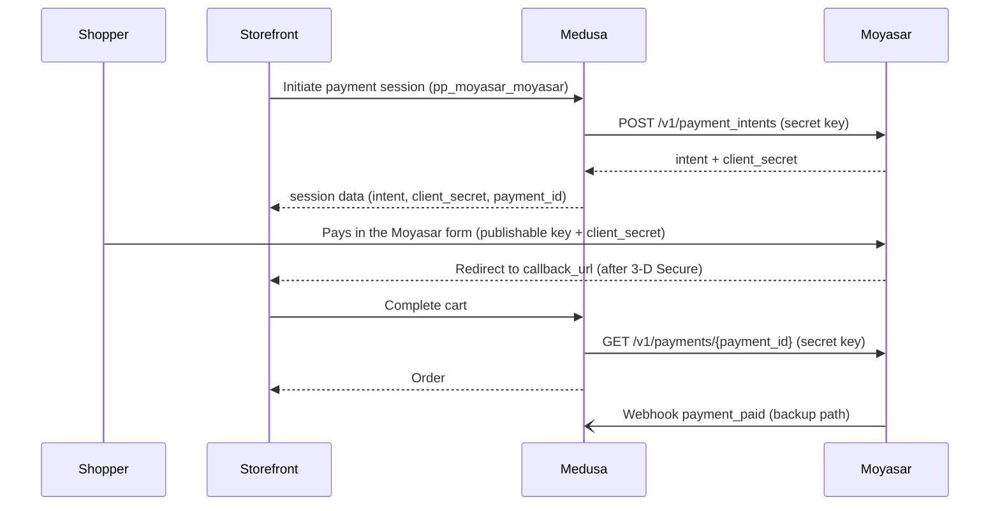

# Moyasar for Medusa

Accept mada, Visa, Mastercard, Apple Pay, Samsung Pay and STC Pay in a [Medusa v2](https://medusajs.com) store through [Moyasar](https://moyasar.com).

- **Server-side amounts.** Every checkout runs on a Moyasar [Payment Intent](https://docs.moyasar.com) created with your secret key. The browser can only complete the payment your backend approved, for the amount your backend set.
- **No trust in the browser.** Before Medusa authorizes a session, the provider fetches the payment from Moyasar and checks its ID, amount and currency against the session.
- **Auto or manual capture.** Charge at checkout, or authorize first and capture from the Medusa admin when you fulfil the order.
- **Webhooks.** Orders are still created if the shopper closes the tab after paying. Events are checked against your webhook secret with a constant-time comparison.
- **Refunds and voids** from the Medusa admin, including partial refunds.
- **Multi-currency.** SAR, AED, BHD, KWD, QAR and USD, with correct minor units (including the trailing-zero rule for three-decimal currencies).

Requires Medusa `>= 2.12` and Node.js `>= 20`.

## How it works



The provider generates the Moyasar payment ID (`given_id`) when it creates the session, so it always knows which payment belongs to which cart without trusting anything the browser sends back.

## 1. Install

```bash
npm install medusa-plugin-moyasar
```

## 2. Configure Medusa

```ts
// medusa-config.ts
module.exports = defineConfig({
  modules: [
    {
      resolve: "@medusajs/medusa/payment",
      options: {
        providers: [
          {
            resolve: "medusa-plugin-moyasar",
            id: "moyasar",
            options: {
              secretKey: process.env.MOYASAR_SECRET_KEY,
              publishableKey: process.env.MOYASAR_PUBLISHABLE_KEY,
              webhookSecret: process.env.MOYASAR_WEBHOOK_SECRET,
              callbackUrl: process.env.MOYASAR_CALLBACK_URL,
            },
          },
        ],
      },
    },
  ],
})
```

| Option | Required | Default | Description |
| --- | --- | --- | --- |
| `secretKey` | Yes | | `sk_test_…` or `sk_live_…`. Never leaves the server. |
| `publishableKey` | Yes | | `pk_test_…` or `pk_live_…`, same mode as `secretKey`. Sent to the storefront. |
| `webhookSecret` | Recommended | | The secret token you set on the Moyasar webhook. Without it, webhooks are ignored. |
| `callbackUrl` | Yes, unless the storefront sends `callback_url` | | Where Moyasar sends the shopper after 3-D Secure. |
| `capture` | No | `true` | `false` authorizes at checkout. Capture from the admin when you fulfil the order. |
| `methods` | No | `["creditcard", "applepay", "stcpay"]` | Any of `creditcard`, `applepay`, `samsungpay`, `stcpay`. |
| `paymentDescription` | No | `"Medusa order"` | Prefix of the payment description shown in the Moyasar dashboard. |
| `timeoutMs` | No | `30000` | Timeout for each Moyasar API call. |
| `maxNetworkRetries` | No | `2` | Retries for reads and intent creation on network errors, 429 and 5xx. Captures, voids and refunds are never retried blindly. |

Then enable **Moyasar** (`pp_moyasar_moyasar`) on your regions in the Medusa admin under **Settings → Regions**.

## 3. Set up the webhook

In the [Moyasar dashboard](https://dashboard.moyasar.com) under **Settings → Webhooks**, add:

- **URL:** `https://<your-medusa-backend>/hooks/payment/moyasar_moyasar`
- **HTTP method:** `POST`
- **Secret token:** the same value as `webhookSecret`
- **Events:** `payment_paid`, `payment_authorized`, `payment_captured`, `payment_failed`, `payment_voided`

Moyasar then sends a verification code to the webhook. The provider writes it to the Medusa server log (`Moyasar: webhook verification code is …`). Enter it in the dashboard to activate the webhook.

## 4. Add the payment form to your storefront

The storefront renders the official [Moyasar payment form](https://www.npmjs.com/package/moyasar-payment-form) using the session data Medusa returns.

```bash
npm install moyasar-payment-form
```

1. When the shopper picks Moyasar, initiate the session and pass a return URL that includes the cart:

   ```ts
   await sdk.store.payment.initiatePaymentSession(cart, {
     provider_id: "pp_moyasar_moyasar",
     data: {
       callback_url: `${origin}/api/moyasar/callback?cart_id=${cart.id}&country_code=${countryCode}`,
     },
   })
   ```

2. Render the form with the session's `data`. See [`examples/nextjs-starter/moyasar-payment.tsx`](examples/nextjs-starter/moyasar-payment.tsx) for a drop-in component for the [Next.js Starter](https://github.com/medusajs/nextjs-starter-medusa).

   ```tsx
   const session = cart.payment_collection.payment_sessions.find(
     (s) => s.provider_id === "pp_moyasar_moyasar"
   )
   return <MoyasarPayment session={session.data} locale="ar" />
   ```

3. Complete the cart when Moyasar redirects back. See [`examples/nextjs-starter/app/api/moyasar/callback/route.ts`](examples/nextjs-starter/app/api/moyasar/callback/route.ts).

If a card is declined, the intent is used up. Initiate the payment session again to show the form with a fresh one. The provider also refreshes the intent by itself when the cart total changes or the intent is about to expire (Moyasar intents last one hour).

## Status mapping

| Moyasar payment | Medusa session |
| --- | --- |
| no payment yet | `requires_more` (or `error` once the intent expired) |
| `initiated` (3-D Secure pending) | `requires_more` |
| `authorized` | `authorized` |
| `paid`, `captured` | `captured` |
| `failed` | `error` |
| `voided` | `canceled` |
| any successful status with a different ID, amount or currency than the session | `error` |

## Testing

Use your `sk_test_` and `pk_test_` keys and Moyasar's [test cards](https://docs.moyasar.com), for example `4111 1111 1111 1111` (success) or `4000 0000 0000 0002` (3-D Secure).

```bash
npm test
npm run typecheck
```

## License

MIT
